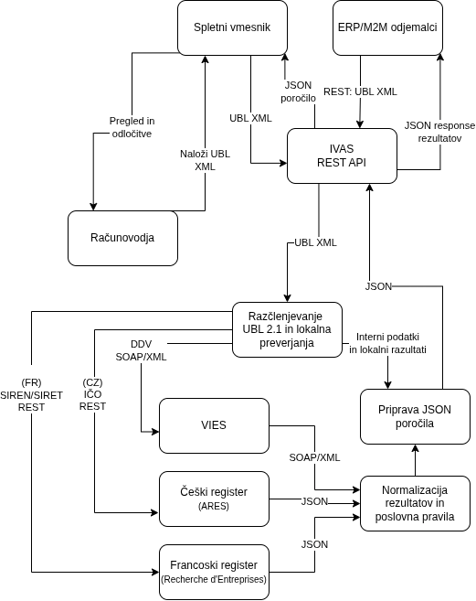

# IVAS – Invoice Verification and Assessment System

**IVAS** je integracijska storitev za predhodno preverjanje strukturiranih elektronskih računov. Namenjena je predvsem manjšim podjetjem in računovodskim servisom, ki prejemajo račune dobaviteljev iz Evropske unije.

Sistem sprejme račun v formatu UBL 2.1 XML, izvede osnovna lokalna preverjanja ter s pomočjo zunanjih spletnih storitev preveri DDV identifikator in izbrane registrske podatke dobavitelja.

Rezultat je strukturirano poročilo JSON s posameznimi preverjanji, zaznanimi neskladji, skupno oceno računa in priporočilom za nadaljnjo obravnavo.

## Integrirana spletna storitev in zunanji viri

| Storitev | Namen | Komunikacija |
|---|---|---|
| VIES | Preverjanje veljavnosti EU DDV številk | SOAP / XML |
| API Recherche d'Entreprises | Preverjanje francoskih dobaviteljev po SIREN/SIRET | REST / JSON |
| ARES | Preverjanje čeških dobaviteljev po IČO | REST / JSON |

**Dokumentacija:**

- VIES: https://ec.europa.eu/taxation_customs/vies/
- Francoski poslovni register: https://recherche-entreprises.api.gouv.fr/docs/
- Češki ARES: https://ares.gov.cz/swagger-ui/

## Prenos in obdelava podatkov

| Podatkovni tok | Oblika | Vsebina |
|---|---|---|
| Odjemalec → IVAS | UBL 2.1 XML | Številka računa, datum, valuta, podatki dobavitelja, identifikatorji in neto zneski postavk |
| IVAS → VIES | SOAP/XML | Državna oznaka in DDV identifikacijska številka |
| VIES → IVAS | SOAP/XML | Veljavnost DDV številke, datum preverjanja in drugi razpoložljivi podatki |
| IVAS → francoski register | HTTP GET | SIREN oziroma SIRET dobavitelja |
| Francoski register → IVAS | JSON | Registrski identifikator, naziv in status podjetja |
| IVAS → ARES | HTTP GET | Češki identifikator IČO |
| ARES → IVAS | JSON | IČO, naziv in drugi razpoložljivi registrski podatki |
| IVAS → odjemalec | JSON | Rezultati preverjanj, ugotovitve, skupna ocena in priporočilo |

### Pravila preverjanja

IVAS bo izvajal osnovno preverjanje strukture UBL računa, primerjavo neto vsot postavk in preverjanje dobavitelja prek razpoložljivih zunanjih storitev.

Pri preverjanju registrske identitete bo uporabljen izrecno naveden registrski identifikator. Ime dobavitelja se bo primerjalo z osnovno normalizacijo zapisa.

Sistem bo razlikoval med uspešnim preverjanjem (`PASS`), ugotovljenim neskladjem (`FAIL`), neizvedenim preverjanjem (`UNKNOWN`) in nerelevantnim preverjanjem (`NOT_APPLICABLE`).

Skupna ocena bo ena od naslednjih:

| Ocena | Pomen |
|---|---|
| `NO_ISSUES_DETECTED` | Pri izvedenih relevantnih preverjanjih ni zaznanih neskladij |
| `REVIEW_REQUIRED` | Zaznano je neskladje, ki zahteva pregled |
| `INCOMPLETE_VERIFICATION` | Pomembnega preverjanja ni bilo mogoče dokončati |

IVAS ne predstavlja celovitega sistema za pravno ali davčno validacijo računov in računov samodejno ne odobrava.

## Načini uporabe

**M2M:** zunanji informacijski sistem posreduje UBL XML prek REST API-ja in prejme JSON poročilo.

**HITL:** uporabnik prek spletnega vmesnika naloži račun in pregleda rezultate ter priporočilo za nadaljnjo obravnavo.

Predvidena API operacija: `POST /api/v1/invoices/check`.

## Arhitektura

## Tehnologije

Predvidena implementacija: Java 25 (Eclipse Temurin), Spring Boot 4.x, Lombok, OpenAPI/Swagger in JUnit 5.

## Status projekta

Naloga 2: samostojni ARES HTML parser, navodila za zagon in dejanski rezultati preverjanja so v
[`docs/Naloga2_Spletni_Parser.md`](docs/Naloga2_Spletni_Parser.md#14-implementacija-in-preverjanje-23-10-2026).
Parser je preverjen na uradnem izrisanem DOM-u ARES; dokumentacija vsebuje Maven ukaze in dejanske rezultate testov.

Projekt je v fazi načrtovanja in začetne implementacije. Zunanje storitve so bile preliminarno preverjene z ročnimi HTTP zahtevki; celoten integracijski tok še ni implementiran.

Za razvoj in demonstracijo so predvideni sintetični UBL računi ter javno dostopni registrski podatki.
